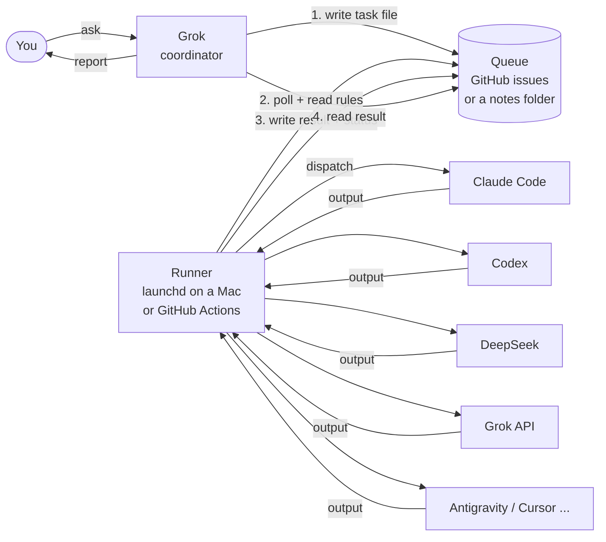

# agent-switchboard

**Use Grok as a coordinator that hands work to other AI tools and hears back.**

This is a *pattern*, not an app you install and forget. It's a small set of conventions plus
sample code you can read in one sitting and change to fit your setup. If you use Grok and you
also pay for (or want to try) Claude Code, Codex, Antigravity, Cursor, DeepSeek, and so on,
this shows one way to have Grok send each job to the right tool and collect the answers.

> New here and not much of a coder? Start with [`grok-template/`](grok-template/). Paste the
> setup prompt into Grok and it will interview you and walk you through the rest.

## The idea in one picture



1. **Grok writes a task file** into a queue. A task file is a short Markdown note with a few
   labeled lines at the top ([spec](spec/task-format.md)).
2. **A runner** wakes up every few minutes, finds `queued` tasks, checks your
   [routing rules](routing/rules.example.yml), and runs the right **worker**.
3. **The runner writes the result back** into the same task file (or as a comment on the
   GitHub issue) and sets the status to `done`, `failed`, or `needs-human`.
4. **Grok reads the result** next time you ask ("anything back from my tasks?") and tells you.

Nothing magic connects the pieces. They pass notes through a shared place. That's the whole trick,
and it's why you can swap any piece out.

## Try it in 30 seconds (no AI accounts needed)

```bash
git clone https://github.com/owenmecham/agent-switchboard && cd agent-switchboard
make demo        # or: ./scripts/demo.sh
make test        # or: python3 -m unittest discover -s tests -v
```

The demo copies a sample "vault" with four tasks to a temp folder, does a dry run, then
processes them with a fake `echo` worker. One task tries a worker that fails and falls back,
and one is an email, so it stops for a human. Needs only Python 3.9+.

## Glossary

| Word | Plain meaning |
|---|---|
| **Coordinator** | Grok. Talks to you, writes tasks, reads results. Doesn't do the heavy work itself. |
| **Task file** | One Markdown note describing one job, with a status line at the top. |
| **Queue** | Where task files wait: GitHub issues, or a folder (an Obsidian vault works). |
| **Runner** | A small script that runs on a schedule, picks up tasks, and runs workers. |
| **Worker** | Any tool that can take a task and print an answer: Claude Code, Codex, an API call... |
| **Routing rules** | A file that says "this kind of task goes to this worker, else that one". |
| **Fallback** | The next worker to try if the first can't run or fails. |
| **needs-human** | A status meaning "a person has to look at this". Not an error, a handoff. |
| **Dry run** | Show what *would* happen without changing anything. |

## Which queue: GitHub or a notes folder?

| | GitHub issues | Notes folder (Obsidian / synced folder) |
|---|---|---|
| Best for | Code work: the worker can open a PR right there | Research, writing, life admin |
| Grok can reach it | Through a GitHub connector | Through a notes connector, or you paste |
| Runs without a Mac | Yes (GitHub Actions) | Needs a computer that has the folder |
| History / audit | Built in | Whatever your sync keeps |
| Setup effort | `gh auth login`, a repo, labels | Make a folder |

Lots of people use **both**: code tasks in GitHub, everything else in the vault. Cloud Brain,
Notion and similar tools fit the same pattern if you write a small adapter (see the
[queue adapter contract](spec/queue-adapter-contract.md)).

## Failover

There are two kinds, and they're different:

- **Worker failover** is built in. Each rule lists fallbacks. If Claude Code isn't installed on
  this machine, or it crashes, the runner tries Codex next. If nothing works, the task goes to
  `needs-human`. Details: [decision-logic.md](routing/decision-logic.md).
- **Queue failover** is a habit you teach Grok. If Grok can't reach GitHub, it writes the task
  to the notes folder instead. Run one runner per queue and both get handled. The setup prompt
  in `grok-template/` includes this instruction.

## Safety (please read)

- **No secrets in this repo, ever.** Workers read API keys from environment variables or the
  macOS Keychain (`runner/workers/_common.sh`). GitHub Actions uses repository secrets.
- **Humans approve anything that leaves the building.** `send`, `merge`, `purchase`, `delete`
  are in `always_needs_human` by default. Code workers should push branches/PRs, never merge.
- **Workers run real commands on your machine.** Claude Code and Codex can edit files. Point
  them at a repo on a branch, read their output, and start with `--dry-run`.
- **Task text is untrusted input.** Anyone who can write to your queue can ask your workers to
  do things. Keep the queue private (private repo, private folder).
- **Caps.** `max_tasks_per_run` and per-worker `max_per_run` stop a runaway loop from burning
  your subscription or API budget.

## What's in here

```
grok-template/   Prompt that turns Grok into the coordinator + a setup interview
spec/            Task file format, result format, queue adapter contract
routing/         Example rules, demo rules, how decisions are made
runner/          Sample runner (Python, standard library only), workers, launchd + Actions examples
examples/        Two full walkthroughs (folder queue, GitHub queue) + the demo vault
tests/           Unit tests for routing and the folder queue round trip
```

## Credit

Inspired by a personal setup Owen Mecham runs to coordinate several coding agents from Grok.
This repo is the cleaned-up, teachable version.

MIT licensed. See [LICENSE](LICENSE) and [CONTRIBUTING.md](CONTRIBUTING.md).
