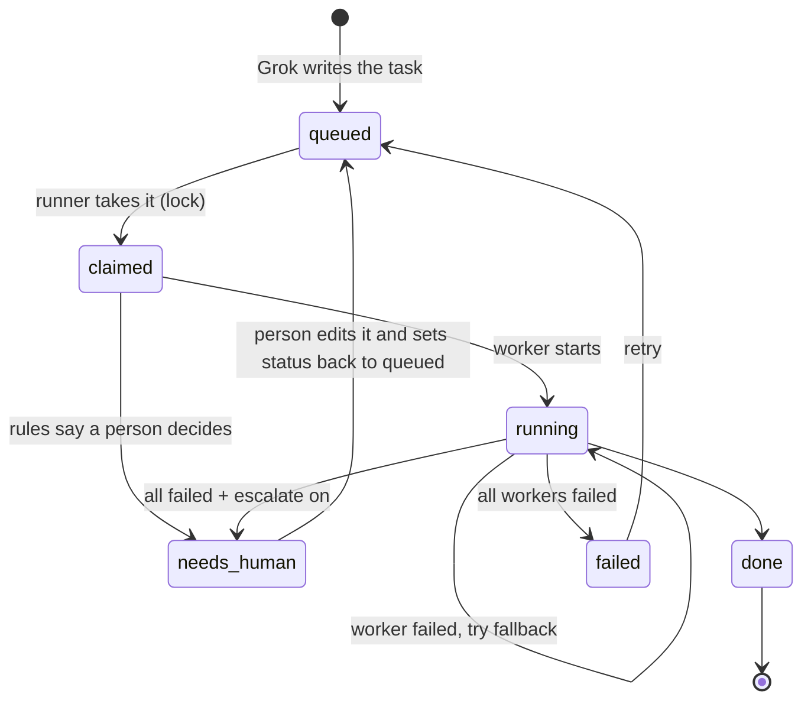

# Task file format

One task = one Markdown file. The top is a block of `key: value` lines between `---` markers
(called "frontmatter"; Obsidian shows it as Properties). Below that is plain Markdown.

```markdown
---
id: 2026-01-15-001            # required, unique. Date + counter works well.
title: Compare three standing desks under $500
type: research                # required. Routing rules match on this.
priority: normal              # low | normal | high
requested_by: grok            # who asked (grok, a person's name, another agent)
created: 2026-01-15T09:00:00+00:00
tags: [home-office]           # optional; rules can match tags_any / tags_all
route:                        # optional hint; the runner tries this worker first
  worker: deepseek
repo_path: ~/code/my-app      # optional; code workers cd here
status: queued                # see lifecycle below
---

## Task
What to do, in plain words.

## Done when
How to tell it's finished.
```

## Fields the runner adds

`claimed_by`, `claimed_at`, `started`, `updated`, `worker`. Don't write these yourself.

## Status lifecycle



| status | meaning | who sets it |
|---|---|---|
| `queued` | waiting | Grok (or you) |
| `claimed` | a runner has it | runner |
| `running` | a worker is on it | runner |
| `done` | finished, result attached | runner |
| `failed` | every worker failed | runner |
| `needs-human` | a person must act | runner |

To retry anything, change `status` back to `queued`. The runner only ever picks up `queued`.

## Allowed types (suggested, make your own)

`research`, `summarize`, `draft`, `code`, `bugfix`, `refactor`, `test`, `review`, and the
always-human ones: `send`, `merge`, `purchase`, `delete`.

## Formatting limits of the built-in reader

The runner reads frontmatter with a tiny YAML reader (no installs needed). Stick to
`key: value`, `[a, b]` lists, and one nested level (like `route:`). If PyYAML is installed,
it's used automatically and anything goes.
